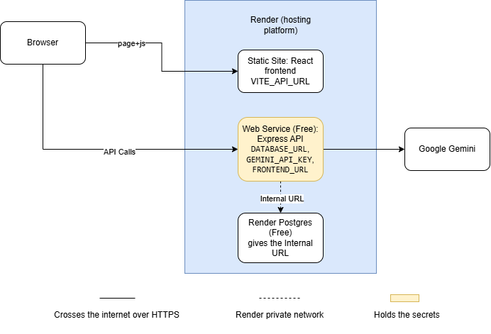

# Activity 4 – Deployment Plan

**Date:** November 12, 2026
**Status:** Plan only. This release was submitted as a local release candidate, and live staging was not completed (see `RELEASE_NOTE.md`).

## 1. Overview

For deployment I chose Render. The instructor said the project will be deployed but did not say which platform to use. I picked Render because it can host the frontend, the backend and the PostgreSQL database for free, and it connects directly to my GitHub repository (github.com/jansdale21/ShopSmart).

The plan uses three parts on Render:

- Frontend (React + Vite) as a Static Site
- Backend (Express API) as a Web Service on the free plan
- Database (PostgreSQL) as Render Postgres on the free plan

The AI assistant uses Google Gemini, but only the backend talks to Gemini. Only fictional products and fake customer details will be used.

## 2. Deployment diagram

The user's browser opens the frontend, then the frontend sends requests to the backend API. Only the backend can connect to the database and to Gemini, so the secret values (`DATABASE_URL` and `GEMINI_API_KEY`) stay on the backend.

## 3. Render settings

The frontend and backend are in the same repository, so the root directory is the main project folder for both.

**Frontend (Static Site)**

- Build command: `npm ci --workspace frontend --include-workspace-root=false && npm run build --workspace frontend`
- Publish directory: `frontend/dist`
- Rewrite rule: `/*` to `/index.html`, so pages like /cart still work when the page is refreshed

**Backend (Web Service)**

- Build command: `npm ci --include=dev --workspace backend --include-workspace-root=false && npm run db:generate --workspace backend`
- Start command: `npm exec --workspace backend -- prisma migrate deploy && npm start --workspace backend`
- Health check path: `/api/health`

**Environment variables**

| Variable | Service | Value | Secret? |
|---|---|---|---|
| `VITE_API_URL` | Frontend | `https://<api-service>.onrender.com/api` | No, this one is public |
| `DATABASE_URL` | Backend | Internal Database URL from Render Postgres | Yes |
| `GEMINI_API_KEY` | Backend | My Gemini API key | Yes |
| `FRONTEND_URL` | Backend | `https://<frontend-site>.onrender.com` | No, but backend only |
| `NODE_ENV` | Backend | `production` | No |
| `NODE_VERSION` | Both | `22` | No |

Render gives the `PORT` automatically, and `server.js` already uses `process.env.PORT`.

Notes:

- `--include=dev` is needed because Prisma is a dev dependency, and it is not installed when `NODE_ENV` is `production`.
- `app.set('trust proxy', 1)` was added in `backend/src/app.js` (commit `6ef54b5`) so the assistant's rate limit counts each visitor separately behind Render's proxy.

## 4. Answers to the deployment questions

**1. Where will the Vite build files be hosted? Which URL will the frontend use for the API?**
The build files (`frontend/dist`) will be hosted on a Render Static Site. The frontend will use the URL in `VITE_API_URL`, which is `https://<api-service>.onrender.com/api`.

**2. Where will the Express server run, and what public URL will serve /api/health?**
The Express server will run on a Render Web Service. The health URL will be `https://<api-service>.onrender.com/api/health`, and it should show `{"status":"ok"}`.

**3. Where will PostgreSQL run, and how will the server receive DATABASE_URL securely?**
PostgreSQL will run on Render Postgres, in the same region as the backend. The Internal Database URL is pasted into the backend's Environment settings on Render. It is never saved in GitHub.

**4. Which origin will be permitted by FRONTEND_URL and the API CORS configuration?**
Only the frontend's Render URL (`https://<frontend-site>.onrender.com`) will be allowed. `app.js` already passes `FRONTEND_URL` to CORS.

**5. Where will a provider key be stored, if present? How will it be kept out of the frontend bundle and repository?**
The Gemini key will be saved as `GEMINI_API_KEY` in the backend's environment variables on Render. It does not start with `VITE_`, so Vite will not put it in the frontend build. The `.env` files are listed in `.gitignore`, so they are not uploaded to GitHub.

**6. How will database migrations be applied before first use, without wiping existing orders?**
The start command runs `prisma migrate deploy` before the server starts. This only applies migrations that have not run yet and does not delete data. `prisma migrate dev` and `npm run db:seed` will not be used on the deployed database, except one seed while the database is still empty.

**7. Who can access the staging app, and will only fictional customer data be used?**
Only the instructor will get the link. Only fake names and `@example.com` emails will be used. Since the app has no login yet, the checkout page shows a notice not to enter real personal information (added in commit `6ef54b5`), and the services will be suspended after grading.

## 5. Database setup steps

1. Create a new Render Postgres database. It starts empty.
2. Deploy the backend. The start command runs `prisma migrate deploy`, which creates the Product, Order and OrderItem tables from the migration.
3. Add the 6 sample products one time only. The free plan has no Shell, so the seed runs from a laptop using the External Database URL. Before running it, check with `npx prisma migrate status` that it is connected to Render and not to localhost.
4. After that, never run `npm run db:seed` again, because it deletes all orders and products.

The local database follows the same rule. It was not reseeded during testing, so orders #5 to #8 are still there.

Note: the free Render database expires after 30 days and has no backups ([Render free plan](https://render.com/docs/free)). This is okay because it only holds fake data for the class.

## 6. Security and privacy

- No `.env` file is uploaded to GitHub. Only the `.env.example` files are in the repository.
- The secret values are only saved in Render's environment settings.
- Only `VITE_API_URL` goes into the frontend build, and it is not a secret ([Vite env docs](https://vite.dev/guide/env-and-mode)).
- CORS only allows the frontend URL.
- No screenshots of the Render environment page.
- Only fake customer details.
- The assistant is limited to 20 requests per minute, and only public product information is sent to Gemini.

## 7. Testing after deployment

After deploying, repeat the smoke test using the live links:

1. Open `/api/health`. The first load can take 30 to 60 seconds because the free plan sleeps after 15 minutes.
2. Check that the 6 products load.
3. Add items to the cart and refresh the page.
4. Place an order using fake details.
5. Ask the assistant "Which keyboard is below ₱2,000?"
6. Check that the stock went down and the data was not reset.
7. Check that no secret is visible in the website or in screenshots.

**Known limitations of this plan**

- The free backend sleeps after 15 minutes of no use, so the first load is slow.
- The free database expires after 30 days.
- There is no login yet, so anyone with the link can place a test order.
- The cart remembers the old stock number (DEF-03), but the server still blocks orders that are more than the stock.
