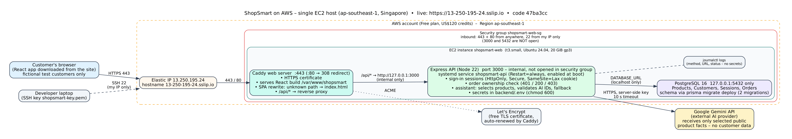

# Activity 6 – Individual ShopSmart Deployment on AWS

**Student:** Jansdale S. Yusi (individual)
**Date:** November 20, 2026
**Release type:** **Hosted** (online), fictional data and simulated checkout only

| Item | Value |
|---|---|
| Site URL | **https://13-250-195-24.sslip.io** |
| API base URL | https://13-250-195-24.sslip.io/api (same origin as the site) |
| Repository | https://github.com/jansdale21/ShopSmart (branch `main`) |
| Deployed code version | commit **`47ba3cc`** – "Add customer sign-in and server-side order ownership" |
| AWS account plan | **Free plan** – US$120.00 credits (US$100 sign-up + US$20 for creating a budget), US$0.00 used on Nov 20, 2026; credits expire Nov 19, 2027, but the Free plan itself ends after 6 months (about May 21, 2027) or when credits run out |
| Region | **ap-southeast-1 (Asia Pacific – Singapore)**, Availability Zone ap-southeast-1c |
| AWS services | Amazon EC2 (instance, EBS gp3 volume, Elastic IP, security group, key pair), AWS Budgets, Billing and Cost Management |
| Software on the instance | Ubuntu 24.04 LTS, Node.js 22, PostgreSQL 16, Caddy (HTTPS), systemd |
| AI provider | Live Google Gemini (server-side only) with rule-based fallback – not a mock |
| Evidence folder | `ShopSmart_Lab_Evidence/06_aws/` (files 01–37) |

Related documents: [decision record](aws-decision-record.md) · [resource register](aws-resource-register.md) · [API examples](API_EXAMPLES.md) · [release note](../RELEASE_NOTE.md)

## 1. Deployment diagram

**One request, traced:** the browser opens `https://13-250-195-24.sslip.io`. Caddy (port 443) returns the React build. React then calls `/api/products` on the same address; Caddy forwards `/api/*` to Express on the internal port 3000; Express reads PostgreSQL on `127.0.0.1:5432` and returns JSON; React shows the products. For an assistant question, Express first selects in-stock catalog products, sends only those public facts to Gemini, and validates the product IDs Gemini returns.

**Ports**

| Port | Public? | Why |
|---|---|---|
| 443 (HTTPS) | Yes | The only real entry point for customers |
| 80 (HTTP) | Yes | Only redirects to HTTPS (308) and lets Let's Encrypt verify the domain |
| 22 (SSH) | My IP only | Administration with the key pair |
| 3000 (Express) | **No** | Internal; reached only through Caddy's `/api/*` proxy |
| 5432 (PostgreSQL) | **No** | Listens on `127.0.0.1` only; the browser never connects to the database |

Evidence: `14_security-group-inbound.png`, `18a/18b_db-and-api-not-public.png` (`TcpTestSucceeded False` for 5432 and 3000 from outside).

## 2. What changed in the application (improvement)

The activity requires that "a fictional test customer should be able to sign in" and that "the API must enforce access to private order records". The starter had no accounts, so I added them (commit `47ba3cc`, 23 files):

- **Database:** new `Customer` and `Session` tables and an optional `customerId` (owner) on `Order`, added as the committed migration `20261120021500_customer_accounts`.
- **Sign-in API:** `POST /api/auth/register`, `/login`, `/logout`, `GET /api/auth/me`. Passwords are stored as salted `scrypt` hashes. Sessions use a random token in an `HttpOnly`, `SameSite=Lax` cookie (also `Secure` in production); the database stores only the token's SHA-256 hash. Login and registration are limited to 10 attempts per minute per visitor, and a wrong email and a wrong password give the same message.
- **Order ownership:** every `/api/orders` route requires a session. The order owner is taken from the session, never from the request body. `GET /api/orders/:id` returns **401** to a guest, **200** to the owner and **403** to any other customer.
- **Frontend:** Sign in / Create account page, "My orders" list, and checkout asks guests to sign in while keeping the cart.
- **Tests:** 13 new backend tests (password hashing, cookies, session middleware, ownership rule) and 1 frontend test. `npm run check`: lint clean, 18 frontend + 19 backend tests pass, build OK (`05_npm-check.log`).
- **Bug found and fixed during local retest:** after a successful order the checkout page showed "Your cart is empty" instead of the success message, because the empty-cart check ran before the success check. Fixed before commit `47ba3cc` and retested locally (`07_local-order-owner.png`) and hosted (`25_hosted-order-success.png`).

**Exam improvements:** the exam instructions for "two improvements and retests" were not provided to me. The improvement completed in this release is customer sign-in with server-side order ownership (above), retested locally (evidence 06–11) and on the hosted site (Check 4 and Check 5 below).

## 3. Migrations and data-preservation decision

| Migration | What it does |
|---|---|
| `20260910094941_initial_schema` | Products, orders and order items (starter) |
| `20261120021500_customer_accounts` | Customers, sessions, optional order owner (this release) |

- **Locally:** applied with `prisma migrate deploy`; `migrate status` → "Database schema is up to date!" and `migrate diff` between the database and `schema.prisma` → "No difference detected." (`04`, `04b`). Existing local orders #5–#8 were **kept**; they have no owner (`customerId = null`), so no customer can read them – this is intentional, instead of deleting or guessing owners.
- **On AWS:** a new empty database; `prisma migrate deploy` applied both committed migrations, then `npm run db:seed` ran **once** to add the 6 starter products (`16a/16b`).
- **Rule:** the seed script deletes orders and replaces products, so it is **never run again** on the deployed database. Future schema changes are committed as migrations and applied with `migrate deploy` only (never `migrate dev` on the server).
- **Persistence proven:** order #1 was still there after an API crash and after a full instance reboot (`33_hosted-order-after-reboot.png`).
- **Backups:** the database lives on the instance's EBS volume, so terminating the instance deletes it. All data is fictional and nothing needs to be kept after grading; if needed, `pg_dump` is run before removal.

## 4. Hosted verification (actual deployment URL)

Base URL: `https://13-250-195-24.sslip.io`. Expected results were written before each check. Test identities are fictional: Ana Reyes (`ana.reyes@example.com`) and Ben Cruz (`ben.cruz@example.com`).

| # | Check | URL / action | Expected | Actual | Status | Evidence |
|---|---|---|---|---|---|---|
| 1 | Frontend and direct route | `/` ; type `/cart` and refresh | Home loads over HTTPS; refreshing a React route still shows the app | Home loaded with padlock (Let's Encrypt certificate, valid to Feb 18, 2027); `/cart` refresh showed the Cart page; server check `/cart → 200` | ✅ Pass | 19, 20, 21, 21b, 22 |
| 2 | API connection | `http://…` and `/api/health` | HTTP redirects to HTTPS; health responds through the HTTPS API | `308 Permanent Redirect` → `https://`; `HTTP/2 200`; `{"status":"ok"}`; no `localhost` API address in the build | ✅ Pass | 19 |
| 3 | Catalog and cart | Products page; search "keyboard"; cart quantities; refresh | Current products appear; search filters; quantity and totals correct and kept after refresh | 6 products from the database; search "keyboard" shows only Compact Mechanical Keyboard (stock now "Only 7 left" after order #1 took 1 of 8); Mouse ×2 + Keyboard ×1 = ₱3,150, `Cart (3)` kept after refresh | ✅ Pass | 20, 23, 36 |
| 4 | Account and order | `GET /api/orders/1` as owner, guest, other customer | Owner 200; guest refused; another customer denied | Ana (owner): **200**, order JSON with `customerId: 1`; signed out: **401** `AUTH_REQUIRED`; Ben: **403** `ORDER_FORBIDDEN`; Ben's "My orders" is empty | ✅ Pass | 27, 28, 29a, 29b |
| 5 | Simulated checkout | `/checkout` as guest, then as Ana; invalid and excess orders | Guest asked to sign in; valid order saved; invalid → 422; excess quantity → 409 | Guest: "Please sign in to check out" with cart kept; Ana: order **#1**, ₱3,150.00, listed in My orders; direct API request with a bad email → **422** `INVALID_ORDER`; 7 webcams (6 in stock) → **409** `INSUFFICIENT_STOCK` "Only 6 unit(s) of 1080p Webcam are available."; no extra order created | ✅ Pass | 24, 25, 26, 37 |
| 6 | Assistant | `/assistant` questions; provider failure test | Claims match current records; no match and provider failure are clear; invalid input refused | "Which keyboard is good for typing assignments?" → Compact Mechanical Keyboard ₱1,850 with catalog link; "Do you sell refrigerators?" → clear no-match; "Hi" → refused (browser: min 3 characters; API: `422 INVALID_QUESTION`); invalid Gemini key → keyboard answer plus "The AI service is temporarily unavailable…", log "Gemini unavailable. Using rule-based fallback." with no key shown; real key restored | ✅ Pass | 30a, 30b, 30c, 31 |
| 7 | Restart and logs | `kill -9` the API; `sudo reboot` | API recovers by itself; logs show the failure without secrets | After `kill -9`: systemd restarted it in 5 s (`restart counter is at 1`), health ok. After reboot (uptime 2 min): `shopsmart-api`, `caddy`, `postgresql` all `active`, HTTPS health ok; journal shows method, URL, status only; order #1 still present | ✅ Pass | 17, 32a, 32b, 33 |
| 8 | Secrets and credits | grep the public build; `git ls-files`; Billing → Credits | No secret in repository, browser files or screenshots; credits within plan | No `AIza`, `GEMINI` or `postgresql://` in `/var/www/shopsmart`; no `.env` tracked in Git; `backend/.env` is `-rw-------`; account ID, home IP and secret values hidden in screenshots; credits US$120.00 available, US$0.00 used | ✅ Pass | 15, 34, 35 |

**Assistant trust boundary (how it is enforced):** the API first selects active, in-stock products that match the question and sends only their public fields to Gemini. Questions containing an email address, phone number or "my order/address/password" are never sent to Gemini. Gemini must return 1–3 product IDs from the selected list; any unknown, duplicate or malformed answer is rejected and the rule-based answer is used. Prices and stock always come from PostgreSQL. Provider errors, timeouts (10 s), malformed drafts and empty catalogs all end in a clear message or a verified fallback, and the assistant route is rate-limited to 20 questions per minute per visitor.

## 5. How the release was deployed (runbook)

1. **AWS account:** Free plan checked in Billing (`01`), root MFA (`02`), zero-spend budget (`03`), Region Singapore, resource register started.
2. **Instance:** EC2 `shopsmart-web` (t3.small, Ubuntu 24.04, 20 GiB gp3), security group `shopsmart-web-sg`, key pair `shopsmart-key`, Elastic IP (`13`, `14`).
3. **Server packages:** updates, 2 GB swap, Node 22 (NodeSource), PostgreSQL 16, Git.
4. **Database and secrets:** database user with a random password generated on the server; `backend/.env` written with `umask 077`; the Gemini key typed with hidden input (`15`).
5. **Code:** `git clone`, version `47ba3cc`; `npm ci`; `npm run db:generate`; `prisma migrate deploy`; `npm run db:seed` once (`16a/16b`).
6. **API service:** systemd unit `shopsmart-api` (`Restart=always`, `WantedBy=multi-user.target`) (`17`).
7. **Frontend:** `VITE_API_URL=/api npm run build`, files copied to `/var/www/shopsmart`.
8. **HTTPS:** Caddy site `13-250-195-24.sslip.io` with `handle /api/*` → `reverse_proxy 127.0.0.1:3000` and `try_files {path} /index.html` (`19`).

**Updating to a new version later:** `git pull` → `npm ci` → `npm exec --workspace backend -- prisma migrate deploy` → `sudo systemctl restart shopsmart-api` → `VITE_API_URL=/api npm run build` → copy `frontend/dist` to `/var/www/shopsmart`. Never run the seed again.

## 6. Troubleshooting notes (symptoms seen and where to look)

| What I saw | Cause | Fix |
|---|---|---|
| Checkout showed "Your cart is empty" right after placing an order (local) | Empty-cart check ran before the order-success check, so clearing the cart hid the success message | Reordered the checks; order was actually saved (seen in My orders) |
| `prisma migrate diff` printed nothing in the first screenshot | Two commands pasted on one line (`>>` prompt) | Ran it alone → "No difference detected." |
| A new user might see sign-in "work" but protected requests fail | Would happen with HTTP or a cross-site API (cookie not sent) | Avoided by design: one HTTPS origin, `Secure` + `SameSite=Lax` cookie, `trust proxy` set for Caddy |

## 7. Demo dates and removal plan

- **Demo period:** November 20, 2026 until the grade is released (latest December 15, 2026).
- **Removal (in this order):** optional `pg_dump`; terminate instance `shopsmart-web` (deletes the EBS volume); release Elastic IP 13.250.195.24 (an unattached IP still uses credits); delete security group `shopsmart-web-sg`; delete key pair `shopsmart-key` and the local `.pem` file; check Billing → Credits and the resource register; optionally close the AWS account.
- The full inventory with Region, owner, purpose, creation date and planned removal date is in [aws-resource-register.md](aws-resource-register.md).

## 8. Known limitations

- Single EC2 host: one point of failure, no automatic database backups (accepted for a fictional demo).
- `sslip.io` hostname instead of a real domain.
- `npm audit` reports 13 vulnerabilities in third-party packages (5 moderate, 5 high, 3 critical); not addressed in this activity.
- Stock shown in the cart can be outdated (DEF-03); the API still refuses orders above real stock.
- Sessions last 7 days; there is no password reset or email verification (fictional accounts only).

## 9. Tools used

Claude (an AI assistant) helped write the sign-in and ownership code, the server commands and these documents. I created the AWS resources, ran every command and test, captured all evidence, and checked the results myself.
